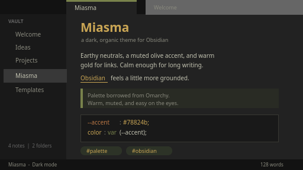

# Miasma for Obsidian

A dark, organic Obsidian theme built from the **Miasma** palette by xero, as shipped with [Omarchy](https://github.com/omacom/omarchy). Earthy neutrals, a muted olive accent, and warm gold accents for links and headings — calm enough for long writing sessions, with enough warmth to keep the interface feeling alive.

## Install

1. Open **Settings → Appearance → Themes** in Obsidian.
2. Click **Manage community themes → Browse**.
3. Search for **Miasma** and select it.

To try it locally before installing, copy `theme.css` into `<your vault>/.obsidian/themes/Miasma/` and select it under **Settings → Appearance**.

## Palette

| Role | Hex |
| --- | --- |
| Background | `#222222` |
| Darker background | `#121212` |
| Lighter background | `#2c2c2c` |
| Foreground | `#c2c2b0` |
| Muted foreground | `#8a8a7e` |
| Accent (olive) | `#78824b` |
| Links / highlight (gold) | `#c9a554` |
| Warm orange | `#b36d43` |
| Green | `#5f875f` |
| Terracotta | `#bb7744` |
| Selection | `#383838` |

The accent follows Obsidian's **Accent color** setting, so you can tweak it from **Settings → Appearance** without losing the rest of the theme.

## What's styled

- Full semantic color mapping: surfaces, text, interactive states, borders, form fields
- Headings, links, blockquotes, horizontal rules, lists and tags
- Inline code and fenced code blocks, including both `--code-*` and legacy `--syntax-*` highlighting
- Tables, properties, callouts, embeds and footnotes
- Ribbon, tabs, sidebars, status bar, modals, popovers and scrollbars
- Graph view and Canvas colors
- Reduced-motion support

Only dark mode is supported, matching the original Miasma palette.

## Fonts

System font stacks are used by default, so the theme works fully offline with no remote assets. To change the reading font, add a snippet that overrides `--font-text-theme` (or edit the variable in the `body` rule of `theme.css`).

## Credits

- Miasma palette by [xero](https://github.com/xero), distributed with Omarchy by [omacom](https://github.com/omacom/omarchy)
- Original Omarchy Miasma theme by J. S. Brown / [OldJobobo](https://github.com/OldJobobo/omarchy-miasma-theme)

## License

MIT — see [LICENSE](./LICENSE). The upstream Miasma palette is also MIT licensed.
